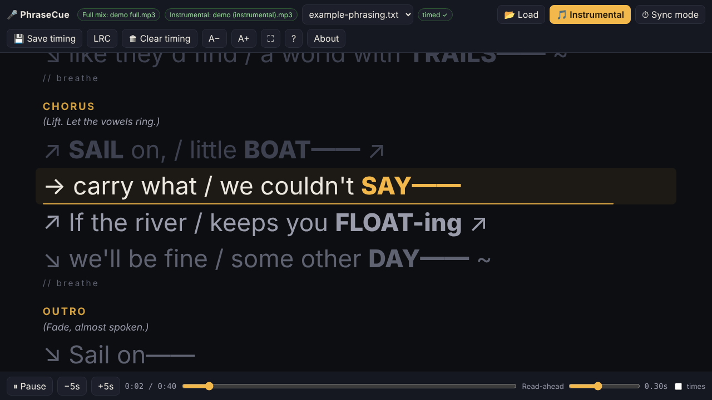

# 🎤 PhraseCue

**A free, private lyric prompter for singers, built around vocal-phrasing notes.**

Load your song's full mix, its instrumental and your lyrics. Tap once through the song to time it, then sing along to the instrumental while each line lights up on cue. Stress marks, pitch arrows, breath marks and performance notes are all shown in place.



**▶ Try it:** https://greenguy27.github.io/phrasecue/

---

## Why PhraseCue

- **Runs anywhere.** It's a single HTML file that works in Chrome, Edge, Safari or Firefox on Windows, macOS or Linux. There's nothing to install and no internet connection needed.
- **Private.** Your audio and lyrics never leave your computer. There are no accounts, uploads, ads or tracking.
- **Phrasing-aware.** Shows **BOLD** stress, `→ ↗ ↘` pitch arrows, `//` breath marks and *(performance directions)* from your phrasing notes, not just plain lyrics.
- **Switch tracks mid-song.** Flip between the full mix and the instrumental mid-song without stopping, so you can listen to a phrase and then sing it.
- **Simple timing.** Tap **Space** at the start of each line. Mistakes are easy to undo or nudge.
- **Portable.** Timing saves as a small `.timing.json` file, or exports as a standard `.lrc` that other karaoke apps can read.
- **Practice tools.** Loop a line, a section or your own A–B range, and slow down to 50% without changing pitch.
- **Timeline.** See the vocal and every line's start under the lyrics. Drag a marker to retime a line, scroll to zoom.
- **Snap (auto-timing assist).** With both mixes loaded, PhraseCue isolates the lead vocal (full mix minus instrumental) and nudges your taps onto the real vocal starts.
- **Record yourself.** Sing over the instrumental, play the take back in sync, and download your voice or a voice-plus-instrumental WAV.

## Quick start

1. Open `index.html` in your browser by double-clicking it, or use the hosted link above.
2. Drag in your files all at once:
   - the **full mix** audio (MP3, WAV, M4A, OGG, FLAC)
   - the **instrumental**. Its file name must contain *without*, *instrumental*, *karaoke*, *backing*, *minus* or *no vocal*, so PhraseCue can tell it apart.
   - one or more **lyrics** files (`.txt`, `.md` or `.lrc`)
3. **Time it, once per lyrics file:** press **S**, then **Space** to start the song, then tap **Space** the moment the singer starts each **blue** line. With both mixes loaded, **🧲 Snap** tightens your taps automatically.
4. **Sing:** press **S** to leave timing mode, **V** for the instrumental, then **Space** to play.
5. **Keep it:** use **Timing ▾ → 💾 Save timing file** and keep the `.timing.json` file next to your song. Next time, or on another computer, drag it in with the other files.

Want to see the lyric formats? Load the files in [`examples/`](examples/) along with any audio file.

## Lyric file formats

### Plain lyrics
```
Song Title

(Verse 1)
First line of the verse
Second line of the verse

(Chorus)
...
```
The first line is the title. Lines in `( )` or `[ ]` are section headers, and every other line is a lyric line.

### Vocal-phrasing guide (Markdown-style)
```
# SONG TITLE
*Genre · Voice · ~84 BPM*

## [VERSE 1]
*(Soft and close to the mic.)*

→ We folded **PA-per** / ↘ on the kitchen floor,
→ wrote our names / on the **SAILS——** ↘

//
```
| Markup | Shown as |
|---|---|
| `# Title` | Song title (first heading) |
| `## [SECTION]` | Section header |
| `*(direction)*` | Performance note in italics |
| `**WORD**` | Stressed word, highlighted |
| `//` | Breath mark |
| `---` | Ignored (spacing only) |
| Any other line | Lyric line that gets timed |

### LRC
Standard `[mm:ss.xx] lyric` files load already timed.

## Instrumental breaks

During an instrumental break, the last line dims and a **♪ Instrumental** bar counts down to the next line.
- **Estimated breaks:** when the gap before the next line is much longer than your usual line length, PhraseCue treats the rest of it as a break, marked *estimated*. You can turn this off with **Timing ▾ → ♪ Estimate breaks**.
- **Exact breaks:** while timing, press `Enter` the moment the singing stops, then keep tapping `Space` when it comes back. `Backspace` undoes the mark, `Shift`+`Enter` removes it, and on the timeline you can drag the blue break marker.
- A section in your phrasing file with no lyric lines, like `## [SHORT INSTRUMENTAL]`, gives the break its name.
- Breaks are saved in the timing file, and exported to `.lrc` as an empty timestamp, which is the standard way to show "no lyrics here".

## Practice tools

- **Loop:** `L` loops the current line, `Shift`+`L` loops the current section, and `A` / `B` set your own start and end. Press `L` again or click the gold loop button to stop.
- **Speed:** the *Speed* menu (or `,` and `.`) plays at 50–110%. Pitch stays the same.
- **Timeline:** the strip above the controls. Gold markers are your lines and blue ticks are detected vocal starts. Click to jump, drag a marker to retime it (hold `Shift` to skip snapping), scroll to zoom, drag to pan, and double-click to zoom back out.
- **Snap:** turned on automatically when both mixes are loaded. Taps land on the nearest strong vocal start. It isn't perfect: if a stamp looks wrong, drag its marker or turn Snap off. It doesn't time the whole song by itself, because word onsets inside a line look just like line starts.
- **Record:** press `R` to start and stop. Recording starts from where you are, or from the loop start, and stops at the loop end. **Wear headphones.** Open **🎙 Takes** (`T`) to play takes back, adjust *Voice timing* if you sound early or late, and download **Voice** (webm/m4a) or **Mix** (WAV, takes recorded at 100% speed). Takes aren't saved after you close the tab.
  - The browser asks for microphone access the first time. Recording works from the hosted link in every browser. Opening the file directly works in Chrome and Edge, but Safari may refuse.
  - Chrome asks once to *allow multiple downloads* the second time you download from the page. Click Allow.

## Keyboard shortcuts

| Key | Action |
|---|---|
| `Space` | Play / pause (in timing mode: stamp the blue line) |
| `P` | Play / pause in any mode |
| `S` | Timing (sync) mode on/off |
| `V` | Full mix ↔ instrumental |
| `←` `→` | Seek 5 seconds |
| `↑` `↓` | Previous / next line |
| `[` `]` | Move the current line 0.1 s earlier / later |
| `Shift` + `[` `]` | Move **all** lines 0.1 s earlier / later |
| `Backspace` | Timing mode: undo the last stamp (or break mark) |
| `Enter` / `Shift`+`Enter` | Mark / remove an instrumental break after the current line |
| `+` `−` | Text size |
| `F` | Full screen |
| `Home` (Mac: `Fn`+`←`) | Back to the start |
| `L` / `Shift`+`L` | Loop current line / section (again = stop) |
| `A` `B` | Set loop start / end |
| `,` `.` | Slower / faster |
| `R` | Record / stop |
| `T` | Show takes |
| `?` | Help |

Click any line to jump to it. The **Read-ahead** slider lights each line up a moment early so you can see what's coming.

## Tips

- **Lines feel late?** Raise *Read-ahead*, or press `Shift`+`[` a few times.
- **Off by a whole line?** You probably tapped at the *end* of each line. Use **Timing ▾ → 🗑 Clear timing** and tap at the *start* of each blue line. The timeline makes this easy to spot: gold markers should sit at the left edge of each vocal phrase.
- Timings are tied to the lyrics file's name and line count. Fixing a typo is fine, but adding or removing a line means retiming from that point. In timing mode, click the line and keep tapping.

## Putting it on your own website

- **Link to it:** turn on GitHub Pages for this repo (Settings → Pages → Deploy from branch → `main` / root) and link to `https://greenguy27.github.io/phrasecue/` (already live for this repo).
- **Self-host:** upload `index.html` to any web host. It's fully self-contained.
- **Embed:** `<iframe src="https://greenguy27.github.io/phrasecue/" style="width:100%;height:85vh;border:0" allow="fullscreen"></iframe>`. Some site builders limit iframes, so a link or button is the most reliable option.

## Privacy

PhraseCue makes no network requests. Files you load and anything you record are processed locally by your browser. Timings are stored in your browser's local storage and in any files you choose to download. Clearing your browser data erases the browser copy, so keep your `.timing.json` files.

## License

[MIT](LICENSE) © 2026 Chris Ross · [CRBooks.ink](https://crbooks.ink)

The sample song in `examples/` was written for this project and may be used freely along with the code.
